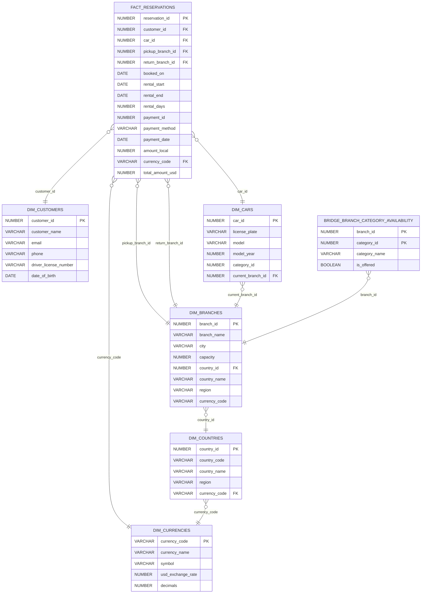

# Avelto Rentals – Gold Layer Star Schema

**Database / schema:** `AVELTO_RENTALS.GOLD`
**Object type:** Snowflake Dynamic Tables (all 7)
**Refresh:** `TARGET_LAG = '3 minutes'`, warehouse `COMPUTE_WH`, `REFRESH_MODE = AUTO`
**Upstream:** `AVELTO_RENTALS.SILVER` Dynamic Tables (`TARGET_LAG = '1 minute'`), fed from `AVELTO_RENTALS.BRONZE`
**Profiled on:** 2026-11-24 (row counts and value ranges below are a snapshot as of this date)

---

## 1. Purpose

The Gold layer is the analytics-ready model of Avelto Rentals' car-rental business. It answers questions such as:

- How many reservations and how much revenue (in USD) did we take, by period, country, region, branch, or car category?
- Which routes (pickup branch → return branch) are most common or most valuable?
- Which customers and vehicles generate the most rentals?
- Which car categories does each branch offer?

All revenue is stored both in the **local payment currency** and **converted to USD**, so figures from different countries can be added together.

---

## 2. Model overview

| Table | Type | Grain (one row per…) | Rows | Business key |
|---|---|---|---|---|
| `FACT_RESERVATIONS` | Fact | reservation | 2,000 | `RESERVATION_ID` |
| `DIM_CUSTOMERS` | Dimension | customer | 500 | `CUSTOMER_ID` |
| `DIM_CARS` | Dimension | vehicle | 210 | `CAR_ID` |
| `DIM_BRANCHES` | Dimension (role-playing) | rental branch | 10 | `BRANCH_ID` |
| `DIM_COUNTRIES` | Reference dimension | country | 7 | `COUNTRY_ID` |
| `DIM_CURRENCIES` | Reference dimension | currency | 6 | `CURRENCY_CODE` |
| `BRIDGE_BRANCH_CATEGORY_AVAILABILITY` | Bridge | branch × car category | 60 | `BRANCH_ID` + `CATEGORY_ID` |

### Entity-relationship diagram



The diagram renders in VS Code's Markdown preview if a Mermaid extension is installed, and natively on GitHub.

### Key conventions

- **Keys are logical, not enforced.** Dynamic tables cannot carry primary- or foreign-key constraints, and every column is reported as nullable. Uniqueness and referential integrity are guaranteed by the Silver data and verified by checks (section 6), not by Snowflake.
- **Natural keys:** the source system's IDs are used directly; there are no surrogate keys.
- **No history:** dimensions show the current state only (Type 1). For example, `DIM_CARS.CURRENT_BRANCH_ID` is where a car is now, not where it was at the time of each reservation.
- **Text columns** are `VARCHAR(16777216)`, Snowflake's default maximum; there is no storage cost for the declared length.

---

## 3. Relationships

| From (many) | To (one) | Join | Meaning |
|---|---|---|---|
| `FACT_RESERVATIONS.CUSTOMER_ID` | `DIM_CUSTOMERS.CUSTOMER_ID` | inner-safe | Who rented |
| `FACT_RESERVATIONS.CAR_ID` | `DIM_CARS.CAR_ID` | inner-safe | Which vehicle was rented |
| `FACT_RESERVATIONS.PICKUP_BRANCH_ID` | `DIM_BRANCHES.BRANCH_ID` | inner-safe | Where the rental started |
| `FACT_RESERVATIONS.RETURN_BRANCH_ID` | `DIM_BRANCHES.BRANCH_ID` | inner-safe | Where the vehicle was returned |
| `FACT_RESERVATIONS.CURRENCY_CODE` | `DIM_CURRENCIES.CURRENCY_CODE` | inner-safe | Currency the customer paid in |
| `DIM_BRANCHES.COUNTRY_ID` | `DIM_COUNTRIES.COUNTRY_ID` | inner-safe | Country of the branch (already denormalised into `DIM_BRANCHES`) |
| `DIM_COUNTRIES.CURRENCY_CODE` | `DIM_CURRENCIES.CURRENCY_CODE` | inner-safe | Country's local currency |
| `DIM_CARS.CURRENT_BRANCH_ID` | `DIM_BRANCHES.BRANCH_ID` | inner-safe | Branch where the car is currently located |
| `BRIDGE_BRANCH_CATEGORY_AVAILABILITY.BRANCH_ID` | `DIM_BRANCHES.BRANCH_ID` | inner-safe | Branch side of the availability matrix |
| `DIM_CARS.CATEGORY_ID` | `BRIDGE_BRANCH_CATEGORY_AVAILABILITY.CATEGORY_ID` | combine with branch | Car category; join on **both** branch and category to check whether a car's category is offered at a branch |

"Inner-safe" means every value currently finds a match (verified, 0 orphans), so an `INNER JOIN` loses no fact rows. Use `LEFT JOIN` if you want queries to stay safe should a future load bring an unmatched key.

### Role-playing branch dimension

A rental can start and end at different branches (1,818 of 2,000 reservations are one-way). `DIM_BRANCHES` is therefore joined **twice**, with a different alias for each role:

```sql
SELECT pb.branch_name AS pickup_branch,
       rb.branch_name AS return_branch,
       COUNT(*)              AS reservations,
       SUM(f.total_amount_usd) AS revenue_usd
FROM AVELTO_RENTALS.GOLD.FACT_RESERVATIONS f
JOIN AVELTO_RENTALS.GOLD.DIM_BRANCHES pb ON pb.branch_id = f.pickup_branch_id
JOIN AVELTO_RENTALS.GOLD.DIM_BRANCHES rb ON rb.branch_id = f.return_branch_id
GROUP BY 1, 2
ORDER BY revenue_usd DESC;
```

### No car-category dimension

There is no `DIM_CAR_CATEGORIES` in Gold. Category names are available via `BRIDGE_BRANCH_CATEGORY_AVAILABILITY.CATEGORY_NAME`, and the full category table (including `DAILY_RATE`) is `AVELTO_RENTALS.SILVER.STG_CAR_CATEGORIES`. The six categories are Economy, Compact, SUV, Luxury, Sports and Convertible.

---

## 4. Table reference

### 4.1 `FACT_RESERVATIONS`

**Business description:** Every car-rental booking made through the BookWave booking system, together with the single payment received for it. This is the central table for volume, revenue and rental-duration analysis.

**Grain:** one row per reservation. **Rows:** 2,000. **Source:** `SILVER.STG_BOOKWAVE_RESERVATIONS` joined to `SILVER.STG_CURRENCIES`.

| # | Column | Data type | Key | Business description | Technical notes |
|---|---|---|---|---|---|
| 1 | `RESERVATION_ID` | NUMBER(38,0) | PK | Unique reservation number from BookWave. | Source field `reservationId`. |
| 2 | `CUSTOMER_ID` | NUMBER(38,0) | FK → `DIM_CUSTOMERS` | The customer who made the booking. | Source field `customerRef`. 495 of 500 customers have at least one reservation. |
| 3 | `CAR_ID` | NUMBER(38,0) | FK → `DIM_CARS` | The vehicle assigned to the booking. | Source field `vehicleId` (renamed). 200 of 210 cars have been rented. |
| 4 | `PICKUP_BRANCH_ID` | NUMBER(38,0) | FK → `DIM_BRANCHES` | Branch where the customer collects the car. | Source field `pickupBranch`. |
| 5 | `RETURN_BRANCH_ID` | NUMBER(38,0) | FK → `DIM_BRANCHES` | Branch where the customer returns the car. | Source field `dropoffBranch` (renamed). Differs from pickup on 1,818 rows. |
| 6 | `BOOKED_ON` | DATE | | Date the customer made the booking. | Converted from `DD/MM/YYYY` text. Range 2023-08-11 to 2025-08-10. |
| 7 | `RENTAL_START` | DATE | | First day of the rental. | Converted from `DD/MM/YYYY`. Range 2023-08-12 to 2025-09-05. Never before `BOOKED_ON`. |
| 8 | `RENTAL_END` | DATE | | Day the car is due back. | Converted from `DD/MM/YYYY`. Never before `RENTAL_START`. |
| 9 | `RENTAL_DAYS` | NUMBER(9,0) | | Length of the rental in days. | Derived: `DATEDIFF(day, RENTAL_START, RENTAL_END)`. Min 1, average 7.4, max 14. |
| 10 | `PAYMENT_ID` | NUMBER(38,0) | | Identifier of the payment for this reservation. | First element of the source `paymentDetails` array; every reservation currently has exactly one payment. |
| 11 | `PAYMENT_METHOD` | VARCHAR | | How the customer paid. | Values: Credit Card, Debit Card, PayPal, Bank Transfer. |
| 12 | `PAYMENT_DATE` | DATE | | Date the payment was received. | Converted from `DD/MM/YYYY`. Never before `BOOKED_ON`; on 132 rows it falls after `RENTAL_START` (paid during the rental). |
| 13 | `AMOUNT_LOCAL` | NUMBER(12,2) | | Amount paid, in the currency the customer paid in. | Source `amountPaid`. Not additive across currencies; range 31.50 to 417,910.00 (the high end is in JPY). |
| 14 | `CURRENCY_CODE` | VARCHAR | FK → `DIM_CURRENCIES` | ISO currency of `AMOUNT_LOCAL`. | Always equals the pickup branch's country currency. |
| 15 | `TOTAL_AMOUNT_USD` | NUMBER(31,2) | | Amount paid, converted to US dollars. | Derived: `ROUND(AMOUNT_LOCAL × DIM_CURRENCIES.USD_EXCHANGE_RATE, 2)`. Additive; total 1,514,210.12 USD. |

**Measures:** `TOTAL_AMOUNT_USD` (sum), `RENTAL_DAYS` (sum or average), `COUNT(*)` (number of reservations). `AMOUNT_LOCAL` should only be summed within a single currency.

**Exchange-rate note:** the conversion uses the **current** rate in `DIM_CURRENCIES`, not the rate on the payment date. If a rate is updated, `TOTAL_AMOUNT_USD` is recalculated for all historic reservations on the next refresh.

### 4.2 `DIM_CUSTOMERS`

**Business description:** People who have an Avelto Rentals customer account and may book cars.

**Grain:** one row per customer. **Rows:** 500. **Source:** `SILVER.STG_CUSTOMERS`.

| # | Column | Data type | Key | Business description | Technical notes |
|---|---|---|---|---|---|
| 1 | `CUSTOMER_ID` | NUMBER(38,0) | PK | Unique customer number. | Matches `FACT_RESERVATIONS.CUSTOMER_ID`. |
| 2 | `CUSTOMER_NAME` | VARCHAR | | Customer's full name. | **PII.** Trimmed. |
| 3 | `EMAIL` | VARCHAR | | Customer's email address. | **PII.** Lowercased and trimmed; all values pass a basic format check and are unique. |
| 4 | `PHONE` | VARCHAR | | Customer's phone number. | **PII.** Trimmed only; formats are mixed (for example `(554)724-9055x11961`, `977.884.1563x39201`, `001-…`). |
| 5 | `DRIVER_LICENSE_NUMBER` | VARCHAR | | Driving licence number provided at registration. | **PII.** Uppercased and trimmed. |
| 6 | `DATE_OF_BIRTH` | DATE | | Customer's date of birth, for age checks. | **PII.** Converted from `YYYY-MM-DD`. Range 1949-08-22 to 2004-07-03. |

**Data protection:** this table contains unmasked personal data. No masking or row-access policy is applied yet.

### 4.3 `DIM_CARS`

**Business description:** The rental fleet: every vehicle Avelto Rentals can assign to a booking.

**Grain:** one row per vehicle. **Rows:** 210. **Source:** `SILVER.STG_CARS`.

| # | Column | Data type | Key | Business description | Technical notes |
|---|---|---|---|---|---|
| 1 | `CAR_ID` | NUMBER(38,0) | PK | Unique vehicle number. | Matches `FACT_RESERVATIONS.CAR_ID`. |
| 2 | `LICENSE_PLATE` | VARCHAR | | Vehicle registration plate. | Uppercased and trimmed; unique. |
| 3 | `MODEL` | VARCHAR | | Make and model (for example Ford Mustang, Ferrari 488). | Trimmed. |
| 4 | `MODEL_YEAR` | NUMBER(38,0) | | Year the vehicle model was manufactured. | Source column `year` (renamed). Range 2015 to 2026. |
| 5 | `CATEGORY_ID` | NUMBER(38,0) | | Rental category the car belongs to (Economy, Compact, SUV, Luxury, Sports, Convertible). | Category names: `BRIDGE_BRANCH_CATEGORY_AVAILABILITY` or `SILVER.STG_CAR_CATEGORIES`. |
| 6 | `CURRENT_BRANCH_ID` | NUMBER(38,0) | FK → `DIM_BRANCHES` | Branch where the vehicle is located now. | Current snapshot only; not the branch at the time of past reservations. |

### 4.4 `DIM_BRANCHES`

**Business description:** Avelto Rentals' rental locations, with the country, region and local currency each one operates in. Used twice by the fact table: as the pickup branch and as the return branch.

**Grain:** one row per branch. **Rows:** 10. **Source:** `SILVER.STG_BRANCHES` joined to `SILVER.STG_COUNTRIES`.

| # | Column | Data type | Key | Business description | Technical notes |
|---|---|---|---|---|---|
| 1 | `BRANCH_ID` | NUMBER(38,0) | PK | Unique branch number. | Matches `PICKUP_BRANCH_ID` and `RETURN_BRANCH_ID`. |
| 2 | `BRANCH_NAME` | VARCHAR | | Branch display name (for example South Eric Branch). | Trimmed. |
| 3 | `CITY` | VARCHAR | | City the branch is in (for example Austin, Toronto, Osaka). | Trimmed. |
| 4 | `CAPACITY` | NUMBER(38,0) | | Number of vehicles the branch can hold. | Range 21 to 96. |
| 5 | `COUNTRY_ID` | NUMBER(38,0) | FK → `DIM_COUNTRIES` | Country the branch is in. | |
| 6 | `COUNTRY_NAME` | VARCHAR | | Country name. | Denormalised from `DIM_COUNTRIES`. |
| 7 | `REGION` | VARCHAR | | World region: North America, Europe, Asia or Oceania. | Denormalised from `DIM_COUNTRIES`. |
| 8 | `CURRENCY_CODE` | VARCHAR | | Local currency the branch charges in. | Denormalised from `DIM_COUNTRIES`; matches the currency of every reservation picked up here. |

### 4.5 `DIM_COUNTRIES`

**Business description:** Countries where Avelto Rentals operates, with their region and local currency.

**Grain:** one row per country. **Rows:** 7. **Source:** `SILVER.STG_COUNTRIES`.

| # | Column | Data type | Key | Business description | Technical notes |
|---|---|---|---|---|---|
| 1 | `COUNTRY_ID` | NUMBER(38,0) | PK | Unique country number. | |
| 2 | `COUNTRY_CODE` | VARCHAR | | Two-letter ISO country code (US, CA, DE, GB, FR, JP, AU). | Uppercased. |
| 3 | `COUNTRY_NAME` | VARCHAR | | Country name. | Trimmed. |
| 4 | `REGION` | VARCHAR | | World region: North America, Europe, Asia or Oceania. | |
| 5 | `CURRENCY_CODE` | VARCHAR | FK → `DIM_CURRENCIES` | Country's local currency. | EUR is shared by Germany and France. |

### 4.6 `DIM_CURRENCIES`

**Business description:** Currencies customers pay in, with the exchange rate used to report revenue in US dollars.

**Grain:** one row per currency. **Rows:** 6 (USD, CAD, EUR, GBP, JPY, AUD). **Source:** `SILVER.STG_CURRENCIES`.

| # | Column | Data type | Key | Business description | Technical notes |
|---|---|---|---|---|---|
| 1 | `CURRENCY_CODE` | VARCHAR | PK | Three-letter ISO currency code. | Uppercased. |
| 2 | `CURRENCY_NAME` | VARCHAR | | Currency name (for example Canadian Dollar). | |
| 3 | `SYMBOL` | VARCHAR | | Display symbol (for example $, CA$, €, £, ¥, A$). | |
| 4 | `USD_EXCHANGE_RATE` | NUMBER(18,6) | | Value of one unit of this currency in US dollars (USD = 1.0, JPY = 0.0067). | Multiply a local amount by this to get USD. A single current rate; no history. |
| 5 | `DECIMALS` | NUMBER(38,0) | | Number of minor-unit decimals the currency uses (2 for most, 0 for JPY). | Useful for display formatting. |

### 4.7 `BRIDGE_BRANCH_CATEGORY_AVAILABILITY`

**Business description:** Which car categories each branch offers to customers. A complete matrix of every branch against every category.

**Grain:** one row per branch × car category. **Rows:** 60 (10 branches × 6 categories); 53 combinations are offered. **Source:** `SILVER.STG_BRANCH_CATEGORY_AVAILABILITY`.

| # | Column | Data type | Key | Business description | Technical notes |
|---|---|---|---|---|---|
| 1 | `BRANCH_ID` | NUMBER(38,0) | PK (part), FK → `DIM_BRANCHES` | The branch. | |
| 2 | `CATEGORY_ID` | NUMBER(38,0) | PK (part) | The car category. | Matches `DIM_CARS.CATEGORY_ID`. |
| 3 | `CATEGORY_NAME` | VARCHAR | | Category name: Economy, Compact, SUV, Luxury, Sports or Convertible. | Carried from the source file; matches the category master data. |
| 4 | `IS_OFFERED` | BOOLEAN | | TRUE if customers can book this category at this branch. | The 7 FALSE rows are all Convertible. Every reservation's car category is offered at its pickup branch. |

---

## 5. Lineage and refresh

```
Stage @BRONZE.BRONZE_LANDING_STAGE (7 CSV + 1 JSON)
        │  loaded as tables
        ▼
BRONZE.* (8 tables, text columns / raw VARIANT)
        │  Dynamic Tables, TARGET_LAG 1 minute
        ▼
SILVER.STG_* (8 tables: typed, trimmed, data-quality flags)
        │  Dynamic Tables, TARGET_LAG 3 minutes
        ▼
GOLD (FACT_RESERVATIONS, 5 DIM_*, 1 BRIDGE_*)
```

| Gold table | Built from (Silver) |
|---|---|
| `FACT_RESERVATIONS` | `STG_BOOKWAVE_RESERVATIONS`, `STG_CURRENCIES` |
| `DIM_CUSTOMERS` | `STG_CUSTOMERS` |
| `DIM_CARS` | `STG_CARS` |
| `DIM_BRANCHES` | `STG_BRANCHES`, `STG_COUNTRIES` |
| `DIM_COUNTRIES` | `STG_COUNTRIES` |
| `DIM_CURRENCIES` | `STG_CURRENCIES` |
| `BRIDGE_BRANCH_CATEGORY_AVAILABILITY` | `STG_BRANCH_CATEGORY_AVAILABILITY` |

- **Freshness:** a change in Bronze appears in Gold within about 4 minutes (1 minute for Silver plus 3 minutes for Gold). Measured on 2026-11-24, Gold's highest lag was 111 seconds and its average 50 seconds.
- **Refresh modes:** `FACT_RESERVATIONS`, `DIM_CUSTOMERS` and `DIM_CURRENCIES` refresh incrementally (ADAPTIVE). The other four refresh in FULL mode because their Silver sources do; at these sizes the cost is negligible.
- **Data-quality flags** (`is_known_*`, `has_valid_currency`, `is_valid_email`, `branch_name_matches`) live in Silver and are not carried into Gold.

---

## 6. Data quality (verified 2026-11-24)

| Check | Result |
|---|---|
| Row count of each Gold table equals its number of distinct keys | Pass, all 7 |
| Gold row counts equal Bronze / source-file counts | Pass (2,000 / 500 / 210 / 10 / 7 / 6 / 60) |
| Every `PICKUP_BRANCH_ID` and `RETURN_BRANCH_ID` exists in `DIM_BRANCHES` | Pass, 0 orphans |
| Every `CUSTOMER_ID`, `CAR_ID` and `CURRENCY_CODE` in the fact exists in its dimension | Pass, 0 orphans |
| `TOTAL_AMOUNT_USD` populated | Pass, 0 NULLs |
| Every branch has a country; every country has a currency | Pass |
| Reservation currency matches pickup branch's local currency | Pass, 0 mismatches |
| `RENTAL_START` ≥ `BOOKED_ON` and `RENTAL_END` ≥ `RENTAL_START` | Pass |
| Every booked car's category is offered at its pickup branch | Pass |

---

## 7. Known limitations

- **One payment per reservation:** only the first element of the source `paymentDetails` array is kept. Today every reservation has exactly one payment; a reservation with several payments would under-report revenue.
- **Current exchange rates:** USD conversion uses today's rate, not the payment-date rate.
- **Type 1 dimensions:** no history of changes to customers, cars or branches (for example a car moving branch).
- **No date dimension:** dates are stored as `DATE` columns; there is no calendar table for fiscal periods or holidays.
- **No car-category dimension in Gold:** see section 3.
- **Unmasked PII** in `DIM_CUSTOMERS`.
- **Unenforced keys:** primary and foreign keys are documented here but not declared in Snowflake.

---

## 8. Example queries

**Monthly revenue in USD by pickup region**

```sql
SELECT DATE_TRUNC('month', f.rental_start) AS month,
       b.region,
       COUNT(*)                AS reservations,
       SUM(f.total_amount_usd) AS revenue_usd
FROM AVELTO_RENTALS.GOLD.FACT_RESERVATIONS f
JOIN AVELTO_RENTALS.GOLD.DIM_BRANCHES b ON b.branch_id = f.pickup_branch_id
GROUP BY 1, 2
ORDER BY 1, 2;
```

**Revenue and average rental length by car category**

```sql
SELECT a.category_name,
       COUNT(*)                AS reservations,
       AVG(f.rental_days)      AS avg_rental_days,
       SUM(f.total_amount_usd) AS revenue_usd
FROM AVELTO_RENTALS.GOLD.FACT_RESERVATIONS f
JOIN AVELTO_RENTALS.GOLD.DIM_CARS c ON c.car_id = f.car_id
JOIN AVELTO_RENTALS.GOLD.BRIDGE_BRANCH_CATEGORY_AVAILABILITY a
  ON a.branch_id = f.pickup_branch_id AND a.category_id = c.category_id
GROUP BY 1
ORDER BY revenue_usd DESC;
```

**Top 10 customers by USD spend**

```sql
SELECT cu.customer_id, cu.customer_name,
       COUNT(*)                AS reservations,
       SUM(f.total_amount_usd) AS revenue_usd
FROM AVELTO_RENTALS.GOLD.FACT_RESERVATIONS f
JOIN AVELTO_RENTALS.GOLD.DIM_CUSTOMERS cu ON cu.customer_id = f.customer_id
GROUP BY 1, 2
ORDER BY revenue_usd DESC
LIMIT 10;
```
