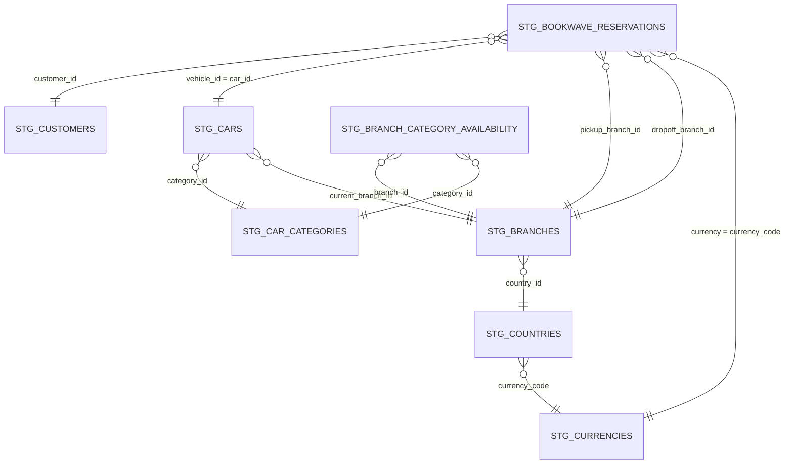

# Avelto Rentals – Silver Layer

**Database / schema:** `AVELTO_RENTALS.SILVER`
**Object type:** Snowflake Dynamic Tables (all 8)
**Refresh:** `TARGET_LAG = '1 minute'`, warehouse `COMPUTE_WH`, `REFRESH_MODE = AUTO`
**Upstream:** `AVELTO_RENTALS.BRONZE` (raw tables loaded from stage `BRONZE_LANDING_STAGE`)
**Downstream:** `AVELTO_RENTALS.GOLD` star schema (see `gold/Gold layer star schema documentation.md`)
**Profiled on:** 2026-11-24 (row counts are a snapshot as of this date)

---

## 1. Purpose

Silver is the **cleaned and standardised** copy of the Bronze data. It keeps the **same grain** as each Bronze table (no rows added, removed or merged) and does three things:

1. **Types** every column. Bronze holds text (or raw JSON); Silver has proper `NUMBER`, `DATE` and `BOOLEAN` columns.
2. **Standardises** values: text trimmed; codes, licence plates and driver's licence numbers uppercased; emails lowercased; `DD/MM/YYYY` dates converted to `DATE`.
3. **Flags** data-quality problems in extra `BOOLEAN` columns (`is_known_*`, `has_valid_currency`, `is_valid_email`, `branch_name_matches`) instead of dropping bad rows, so problems stay visible.

All conversions use `TRY_` functions, so a malformed value becomes NULL instead of failing the refresh.

---

## 2. Table overview

| Silver table | Grain (one row per…) | Rows | Business key | Bronze source | Refresh mode | SQL file |
|---|---|---|---|---|---|---|
| `STG_BOOKWAVE_RESERVATIONS` | reservation | 2,000 | `RESERVATION_ID` | `BRONZE_BOOKWAVE_RESERVATIONS_RAW` | ADAPTIVE | `STG_BOOKWAVE_RESERVATIONS.sql` |
| `STG_CUSTOMERS` | customer | 500 | `CUSTOMER_ID` | `BRONZE_CUSTOMERS` | ADAPTIVE | `STG_CUSTOMERS.sql` |
| `STG_CARS` | vehicle | 210 | `CAR_ID` | `BRONZE_CARS` (+ categories, branches) | FULL | `STG_CARS.sql` |
| `STG_CAR_CATEGORIES` | car category | 6 | `CATEGORY_ID` | `BRONZE_CAR_CATEGORIES` | ADAPTIVE | `STG_CAR_CATEGORIES.sql` |
| `STG_BRANCHES` | branch | 10 | `BRANCH_ID` | `BRONZE_BRANCHES` (+ countries) | FULL | `STG_BRANCHES.sql` |
| `STG_COUNTRIES` | country | 7 | `COUNTRY_ID` | `BRONZE_COUNTRIES` (+ currencies) | FULL | `STG_COUNTRIES.sql` |
| `STG_CURRENCIES` | currency | 6 | `CURRENCY_CODE` | `BRONZE_CURRENCIES` | ADAPTIVE | `STG_CURRENCIES.sql` |
| `STG_BRANCH_CATEGORY_AVAILABILITY` | branch × car category | 60 | `BRANCH_ID` + `CATEGORY_ID` | `BRONZE_BRANCH_CATEGORY_AVAILABILITY` (+ branches, categories) | FULL | `STG_BRANCH_CATEGORY_AVAILABILITY.sql` |

Four tables refresh in **FULL** mode because they `LEFT JOIN` to another Bronze table on a cleaned key expression (`TRY_TO_NUMBER(TRIM(...))`), which Snowflake can't refresh incrementally. At these sizes the cost is negligible.

---

## 3. Relationships

Silver tables read **only from Bronze**; none depends on another Silver table. The data-quality flags come from `LEFT JOIN`s to Bronze reference tables.

| From | To | Join | Used for |
|---|---|---|---|
| `STG_BOOKWAVE_RESERVATIONS.CUSTOMER_ID` | `STG_CUSTOMERS.CUSTOMER_ID` | logical | Who booked |
| `STG_BOOKWAVE_RESERVATIONS.VEHICLE_ID` | `STG_CARS.CAR_ID` | logical | Which car (renamed `CAR_ID` in Gold) |
| `STG_BOOKWAVE_RESERVATIONS.PICKUP_BRANCH_ID` | `STG_BRANCHES.BRANCH_ID` | logical | Pickup branch |
| `STG_BOOKWAVE_RESERVATIONS.DROPOFF_BRANCH_ID` | `STG_BRANCHES.BRANCH_ID` | logical | Return branch (renamed `RETURN_BRANCH_ID` in Gold) |
| `STG_BOOKWAVE_RESERVATIONS.CURRENCY` | `STG_CURRENCIES.CURRENCY_CODE` | logical | Payment currency |
| `STG_CARS.CATEGORY_ID` | `STG_CAR_CATEGORIES.CATEGORY_ID` | flagged (`is_known_category`) | Car category |
| `STG_CARS.CURRENT_BRANCH_ID` | `STG_BRANCHES.BRANCH_ID` | flagged (`is_known_branch`) | Car's current location |
| `STG_BRANCHES.COUNTRY_ID` | `STG_COUNTRIES.COUNTRY_ID` | flagged (`is_known_country`) | Branch country |
| `STG_COUNTRIES.CURRENCY_CODE` | `STG_CURRENCIES.CURRENCY_CODE` | flagged (`has_valid_currency`) | Country currency |
| `STG_BRANCH_CATEGORY_AVAILABILITY.BRANCH_ID` | `STG_BRANCHES.BRANCH_ID` | flagged (`is_known_branch`, `branch_name_matches`) | Availability branch |
| `STG_BRANCH_CATEGORY_AVAILABILITY.CATEGORY_ID` | `STG_CAR_CATEGORIES.CATEGORY_ID` | flagged (`is_known_category`) | Availability category |

"Logical" means the relationship holds (verified, 0 orphans) but no flag column records it; "flagged" means a `BOOLEAN` column in the table records whether the reference was found. Keys are not enforced: dynamic tables can't declare primary or foreign keys.



---

## 4. Table reference

### 4.1 `STG_BOOKWAVE_RESERVATIONS`

**Business description:** Every car-rental booking exported from the BookWave booking system, with its payment.
**Source:** `BRONZE_BOOKWAVE_RESERVATIONS_RAW`, one `VARIANT` column `RAW` holding each reservation's JSON. Fields are extracted from the JSON; the nested `paymentDetails` array is flattened by taking its first element (every reservation currently has exactly one payment).

| # | Column | Data type | Business description | Transformation |
|---|---|---|---|---|
| 1 | `RESERVATION_ID` | NUMBER(38,0) | Unique reservation number (key). | `raw:reservationId::NUMBER` |
| 2 | `CUSTOMER_ID` | NUMBER(38,0) | Customer who booked. | `raw:customerRef::NUMBER` |
| 3 | `VEHICLE_ID` | NUMBER(38,0) | Vehicle assigned. | `raw:vehicleId::NUMBER` |
| 4 | `PICKUP_BRANCH_ID` | NUMBER(38,0) | Branch where the car is collected. | `raw:pickupBranch::NUMBER` |
| 5 | `DROPOFF_BRANCH_ID` | NUMBER(38,0) | Branch where the car is returned. | `raw:dropoffBranch::NUMBER` |
| 6 | `BOOKED_ON` | DATE | Date the booking was made. | `TRY_TO_DATE(raw:bookedOn, 'DD/MM/YYYY')` |
| 7 | `RENTAL_START` | DATE | First day of the rental. | `TRY_TO_DATE(raw:rentalStart, 'DD/MM/YYYY')` |
| 8 | `RENTAL_END` | DATE | Day the car is due back. | `TRY_TO_DATE(raw:rentalEnd, 'DD/MM/YYYY')` |
| 9 | `PAYMENT_ID` | NUMBER(38,0) | Payment identifier. | `raw:paymentDetails[0]:paymentId` |
| 10 | `AMOUNT_PAID` | NUMBER(12,2) | Amount paid, in the payment currency. | `raw:paymentDetails[0]:amountPaid::NUMBER(12,2)` |
| 11 | `CURRENCY` | VARCHAR | ISO currency of the payment. | `raw:paymentDetails[0]:currency::STRING` |
| 12 | `PAYMENT_METHOD` | VARCHAR | Credit Card, Debit Card, PayPal or Bank Transfer. | `raw:paymentDetails[0]:method::STRING` |
| 13 | `PAYMENT_DATE` | DATE | Date the payment was received. | `TRY_TO_DATE(raw:paymentDetails[0]:paidOn, 'DD/MM/YYYY')` |

### 4.2 `STG_CUSTOMERS`

**Business description:** Avelto Rentals customer accounts. **Contains unmasked personal data (PII).**

| # | Column | Data type | Business description | Transformation |
|---|---|---|---|---|
| 1 | `CUSTOMER_ID` | NUMBER(38,0) | Unique customer number (key). | `TRY_TO_NUMBER(TRIM(id))` |
| 2 | `CUSTOMER_NAME` | VARCHAR | Full name. PII. | `TRIM(name)` |
| 3 | `EMAIL` | VARCHAR | Email address. PII. | `LOWER(TRIM(email))` |
| 4 | `PHONE` | VARCHAR | Phone number. PII. Formats are mixed and left as-is. | `TRIM(phone)` |
| 5 | `DRIVER_LICENSE_NUMBER` | VARCHAR | Driving licence number. PII. | `UPPER(TRIM(driver_license_number))` |
| 6 | `DATE_OF_BIRTH` | DATE | Date of birth. PII. | `TRY_TO_DATE(TRIM(date_of_birth), 'YYYY-MM-DD')` |
| 7 | `IS_VALID_EMAIL` | BOOLEAN | **DQ flag:** email has a basic `name@domain.tld` shape. | `REGEXP_LIKE(TRIM(email), '^[^@ ]+@[^@ ]+\.[^@ ]+$')` |

### 4.3 `STG_CARS`

**Business description:** The rental fleet.

| # | Column | Data type | Business description | Transformation |
|---|---|---|---|---|
| 1 | `CAR_ID` | NUMBER(38,0) | Unique vehicle number (key). | `TRY_TO_NUMBER(TRIM(id))` |
| 2 | `LICENSE_PLATE` | VARCHAR | Registration plate. | `UPPER(TRIM(license_plate))` |
| 3 | `MODEL` | VARCHAR | Make and model. | `TRIM(model)` |
| 4 | `MODEL_YEAR` | NUMBER(38,0) | Model year. | `TRY_TO_NUMBER(TRIM(year))` (renamed from `year`) |
| 5 | `CATEGORY_ID` | NUMBER(38,0) | Rental category. | `TRY_TO_NUMBER(TRIM(category_id))` |
| 6 | `CURRENT_BRANCH_ID` | NUMBER(38,0) | Branch where the car is now. | `TRY_TO_NUMBER(TRIM(current_branch_id))` |
| 7 | `IS_KNOWN_CATEGORY` | BOOLEAN | **DQ flag:** category exists in `BRONZE_CAR_CATEGORIES`. | `LEFT JOIN` match found |
| 8 | `IS_KNOWN_BRANCH` | BOOLEAN | **DQ flag:** current branch exists in `BRONZE_BRANCHES`. | `LEFT JOIN` match found |

### 4.4 `STG_CAR_CATEGORIES`

**Business description:** Rental categories (Economy, Compact, SUV, Luxury, Sports, Convertible) and their standard daily price.

| # | Column | Data type | Business description | Transformation |
|---|---|---|---|---|
| 1 | `CATEGORY_ID` | NUMBER(38,0) | Unique category number (key). | `TRY_TO_NUMBER(TRIM(id))` |
| 2 | `CATEGORY_NAME` | VARCHAR | Category name. | `TRIM(name)` |
| 3 | `DAILY_RATE` | NUMBER(12,2) | Standard daily rental price (40 to 200). | `TRY_TO_DECIMAL(TRIM(daily_rate), 12, 2)` |

This table is not carried into Gold; it is the only place `DAILY_RATE` is available.

### 4.5 `STG_BRANCHES`

**Business description:** Rental locations.

| # | Column | Data type | Business description | Transformation |
|---|---|---|---|---|
| 1 | `BRANCH_ID` | NUMBER(38,0) | Unique branch number (key). | `TRY_TO_NUMBER(TRIM(id))` |
| 2 | `BRANCH_NAME` | VARCHAR | Branch name. | `TRIM(name)` |
| 3 | `CITY` | VARCHAR | City. | `TRIM(city)` |
| 4 | `CAPACITY` | NUMBER(38,0) | Number of vehicles the branch can hold. | `TRY_TO_NUMBER(TRIM(capacity))` |
| 5 | `COUNTRY_ID` | NUMBER(38,0) | Country of the branch. | `TRY_TO_NUMBER(TRIM(country_id))` |
| 6 | `IS_KNOWN_COUNTRY` | BOOLEAN | **DQ flag:** country exists in `BRONZE_COUNTRIES`. | `LEFT JOIN` match found |

### 4.6 `STG_COUNTRIES`

**Business description:** Countries Avelto Rentals operates in.

| # | Column | Data type | Business description | Transformation |
|---|---|---|---|---|
| 1 | `COUNTRY_ID` | NUMBER(38,0) | Unique country number (key). | `TRY_TO_NUMBER(TRIM(country_id))` |
| 2 | `COUNTRY_CODE` | VARCHAR | Two-letter ISO code. | `UPPER(TRIM(country_code))` |
| 3 | `COUNTRY_NAME` | VARCHAR | Country name. | `TRIM(country_name)` |
| 4 | `REGION` | VARCHAR | North America, Europe, Asia or Oceania. | `TRIM(region)` |
| 5 | `CURRENCY_CODE` | VARCHAR | Local currency. | `UPPER(TRIM(currency_code))` |
| 6 | `HAS_VALID_CURRENCY` | BOOLEAN | **DQ flag:** currency exists in `BRONZE_CURRENCIES`. | `LEFT JOIN` match found |

### 4.7 `STG_CURRENCIES`

**Business description:** Payment currencies and their exchange rate to US dollars.

| # | Column | Data type | Business description | Transformation |
|---|---|---|---|---|
| 1 | `CURRENCY_CODE` | VARCHAR | Three-letter ISO code (key). | `UPPER(TRIM(currency_code))` |
| 2 | `CURRENCY_NAME` | VARCHAR | Currency name. | `TRIM(currency_name)` |
| 3 | `SYMBOL` | VARCHAR | Display symbol. | `TRIM(symbol)` |
| 4 | `USD_EXCHANGE_RATE` | NUMBER(18,6) | USD value of one unit of this currency. | `TRY_TO_DECIMAL(TRIM(usd_exchange_rate), 18, 6)` |
| 5 | `DECIMALS` | NUMBER(38,0) | Minor-unit decimals (0 for JPY, otherwise 2). | `TRY_TO_NUMBER(TRIM(decimals))` |

### 4.8 `STG_BRANCH_CATEGORY_AVAILABILITY`

**Business description:** Which car categories each branch offers; a full 10 × 6 matrix.

| # | Column | Data type | Business description | Transformation |
|---|---|---|---|---|
| 1 | `BRANCH_ID` | NUMBER(38,0) | Branch (key part). | `TRY_TO_NUMBER(TRIM(branch_id))` |
| 2 | `BRANCH_NAME` | VARCHAR | Branch name as written in the source file. | `TRIM(branch_name)` |
| 3 | `CATEGORY_ID` | NUMBER(38,0) | Car category (key part). | `TRY_TO_NUMBER(TRIM(category_id))` |
| 4 | `CATEGORY_NAME` | VARCHAR | Category name as written in the source file. | `TRIM(category_name)` |
| 5 | `IS_OFFERED` | BOOLEAN | TRUE if the branch offers this category. | `TRY_TO_BOOLEAN(TRIM(is_offered))` |
| 6 | `IS_KNOWN_BRANCH` | BOOLEAN | **DQ flag:** branch exists in `BRONZE_BRANCHES`. | `LEFT JOIN` match found |
| 7 | `IS_KNOWN_CATEGORY` | BOOLEAN | **DQ flag:** category exists in `BRONZE_CAR_CATEGORIES`. | `LEFT JOIN` match found |
| 8 | `BRANCH_NAME_MATCHES` | BOOLEAN | **DQ flag:** branch name here equals the name in `BRONZE_BRANCHES`. | `TRIM(a.branch_name) = TRIM(b.name)` |

---

## 5. Data quality (verified)

| Check | Result |
|---|---|
| Each Silver table has the same row count as its Bronze source | Pass, all 8 |
| No duplicate keys; no duplicate licence plates or emails | Pass |
| Every `TRY_` conversion succeeded (no NULLs introduced) | Pass |
| Every DQ flag column is TRUE on every row | Pass |
| Every reservation's customer, vehicle, pickup branch, dropoff branch and currency exists | Pass, 0 orphans |
| Reservation currency equals the pickup branch's country currency | Pass |
| `RENTAL_START` ≥ `BOOKED_ON`; `RENTAL_END` ≥ `RENTAL_START` | Pass |

To recheck the flags at any time:

```sql
SELECT 'STG_COUNTRIES' t, COUNT_IF(NOT has_valid_currency) bad FROM AVELTO_RENTALS.SILVER.STG_COUNTRIES
UNION ALL SELECT 'STG_BRANCHES', COUNT_IF(NOT is_known_country) FROM AVELTO_RENTALS.SILVER.STG_BRANCHES
UNION ALL SELECT 'STG_CARS', COUNT_IF(NOT is_known_category OR NOT is_known_branch) FROM AVELTO_RENTALS.SILVER.STG_CARS
UNION ALL SELECT 'STG_CUSTOMERS', COUNT_IF(NOT is_valid_email) FROM AVELTO_RENTALS.SILVER.STG_CUSTOMERS
UNION ALL SELECT 'STG_BRANCH_CATEGORY_AVAILABILITY', COUNT_IF(NOT is_known_branch OR NOT is_known_category OR NOT branch_name_matches) FROM AVELTO_RENTALS.SILVER.STG_BRANCH_CATEGORY_AVAILABILITY;
```

---

## 6. Recreating the Silver layer

Each `.sql` file in this folder recreates one table with `CREATE OR REPLACE DYNAMIC TABLE` and starts with `CREATE SCHEMA IF NOT EXISTS AVELTO_RENTALS.SILVER`, so the files can be run in **any order**: Silver tables depend only on Bronze.

**Prerequisites:**
- The 8 Bronze tables exist in `AVELTO_RENTALS.BRONZE` with **uppercase** table and column names (they were renamed from quoted lowercase names during this project).
- Warehouse `COMPUTE_WH` exists, and the role (`SYSADMIN` was used) can create dynamic tables in the schema.

**Caution:** `CREATE OR REPLACE` drops and rebuilds the table. The Gold dynamic tables that read from it will reinitialise on their next refresh.

---

## 7. Known limitations

- **One payment per reservation:** only `paymentDetails[0]` is kept.
- **Bad values become NULL, not errors:** watch the DQ flags and NULL counts after new loads.
- **Phone numbers** are not standardised.
- **Unmasked PII** in `STG_CUSTOMERS`.
- **Keys are logical only;** no constraints are declared.
